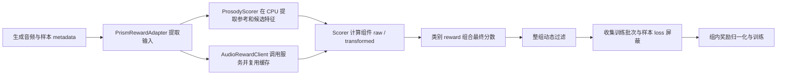

# Prism 奖励：调用、评分、组合与过滤

从本页开始配置奖励。服务负责返回转写文本或 embedding；训练 worker 计算组件分数，
类别函数组合最终 reward，Slime 的 rollout hook 决定哪些候选进入训练以及是否贡献 loss。



两个过滤 hook 均默认关闭。reward 为零、整组拒绝、样本 loss 屏蔽的训练语义见
[过滤](#过滤)。技术故障会抛错，不作为低质量候选处理。

## 文件与配置入口

| 要修改的行为 | 文件入口 | 如何接入 |
| --- | --- | --- |
| 服务启动、模型和部署环境 | [`reward_services/start_*.sh`](../reward_services/)、[部署说明](../reward_services/README.md) | 在独立服务环境启动需要的模型 |
| 服务 URL、认证、并发、请求超时 | [`configs/rewards.yaml`](../configs/rewards.yaml) 的 `services` | `--omni-reward-config` |
| HTTP 调用、协议与客户端生命周期 | [`client.py`](../../../slime_plugins/audio_rewards/client.py) 的 `ServiceClient`、[`transport.py`](../../../slime_plugins/audio_rewards/transport.py) | 通常通过 `AudioRewardClient` 使用 |
| 组件请求编排、参考/文本缓存 | 同一 `client.py` 的 `AudioRewardClient` | `wer()`、`sim()`、`judge_clap()` |
| 韵律特征、距离与参考特征缓存 | [`prosody.py`](../../../slime_plugins/audio_rewards/prosody.py) | 顶层 `prosody.processes` 控制每个 rollout worker 的 CPU 子进程数 |
| 默认组件数学、自定义函数加载 | [`scoring.py`](../../../slime_plugins/audio_rewards/scoring.py) | YAML 的 `scorers.<组件名>.path/kwargs` |
| 自定义组件算法示例 | [`scorers.py`](scorers.py) | 直接填写示例函数路径，或复制后修改 |
| Prism 音频路径、目标文本、参考绑定、指令展开 | [`reward_adapter.py`](../../../slime_plugins/prism/reward_adapter.py) | 类别 hook 自动调用 |
| 选择组件、组合最终 reward | [`base.py`](base.py)、[`voiceclone.py`](voiceclone.py)、[`instruction.py`](instruction.py)、[`voiceclone_gated.py`](voiceclone_gated.py) | `--custom-rm-path`；线性系数放在 YAML 的 `weights` |
| 按样本类别分发 | [`__init__.py`](__init__.py) 的 `CATEGORY_REWARDS` | `examples.prism.rewards.reward` + `metadata.reward_category` |
| 状态接线、批量调用、聚合结果记录 | [`common.py`](common.py) | 类别函数复用 `score()` 和 `reward_states` |
| reward 后的训练过滤示例 | [`filters.py`](filters.py) | 两个原生 filter CLI hook |
| 分数、候选归档、耗时诊断 | [`artifacts.py`](../../../slime_plugins/prism/artifacts.py)、[`metrics.py`](../../../slime_plugins/prism/metrics.py) | [评分诊断](../docs/REWARD_SERVICES.md#联合评分变慢时怎么定位) |

`common.py` 获取共享状态并管理调用流程；`RewardStateCache` 在 adapter 模块中管理
每个事件循环/配置的状态，向量缓存实际归 `AudioRewardClient` 所有。
客户端和服务运行代码安装在 `slime_plugins`；本目录保存任务策略和可复制的示例。
服务实现位于 [`audio_rewards/serving/`](../../../slime_plugins/audio_rewards/serving/)，不依赖本目录。

## 启动与调用服务

只启动所选 reward 需要的服务。下面的命令在准备好模型和依赖的**服务环境**中分别执行；
各进程需要独立的地址/端口或容器。模型路径、认证及部署资源见[部署说明](../reward_services/README.md)。

| 组件 | 可用启动脚本 | 返回内容 |
| --- | --- | --- |
| `wer` | `bash examples/prism/reward_services/start_qwen3_asr.sh` 或 `start_whisper.sh` | ASR 转写文本 |
| `sim` | `bash examples/prism/reward_services/start_redimnet2.sh` | 说话人单位向量 |
| `judge_clap` | `bash examples/prism/reward_services/start_judge_clap.sh` | 音频及属性文本的未归一化向量 |

填写 [`rewards.yaml`](../configs/rewards.yaml) 的服务根地址和认证环境变量。
WER 使用 `openai_audio`，SIM/JudgeCLAP 使用 `voxrl_embedding`。
`concurrency` 是同一配置在当前执行池中的服务总预算，按实际 worker 数分配；
`max_retries` 是额外尝试次数上限，`timeout_s` 包含排队、上传准备和 HTTP/重试时间。
总截止时间耗尽后不会继续重试；当前 `/info` 查询只尝试一次。
缓存、上传路径/数据、并发份额与关闭行为见[参数清单](../reward_services/CONCURRENCY_CONFIG.md)。

常规训练通过 reward hook 调用客户端。调试单个组件时可以直接使用：

```python
import asyncio
from pathlib import Path
import yaml
from slime_plugins.audio_rewards.client import AudioRewardClient


async def main():
    config = yaml.safe_load(Path("examples/prism/configs/rewards.yaml").read_text())
    async with AudioRewardClient(config["services"], scorers=config.get("scorers")) as client:
        result = await client.wer(
            "/shared/candidate.wav",
            target_text="你好，世界！",
            language="Chinese",
            request_id="debug-wer-1",
        )
        print(result["raw"], result["transformed"], result["details"])


asyncio.run(main())
```

替换音频路径并填写服务配置后运行。独立客户端默认按一个 worker 分配预算；自行启动多个
进程时须传入实际 `worker_index` / `worker_count`。训练执行池会自动传递这些信息。
直接调用返回组件记录，不会替调用者组合总 reward 或过滤训练样本。

## 组件评分

默认算法和可直接引用的替换示例：

| 组件 | 默认 `raw` / `transformed` | 示例函数 |
| --- | --- | --- |
| `wer` | WER/CER / `1 / (1 + error_rate)` | `scorers.exponential_wer`：保留原始错误率，奖励改为 `exp(-alpha * error_rate)` |
| `sim` | 单位向量 cosine / `max(0, cosine)` | 可复用通用模块的 `default_sim` 编写自己的变换 |
| `accent` | 直接复用 `sim` 的 raw / transformed | 与音色参考相同时有效，无额外模型调用；随自定义 SIM scorer 一起改变 |
| `prosody` | 18 维特征的分组距离 / `1 / (1 + distance)` | 可复用 `default_prosody` 改变奖励变换 |
| `judge_clap` | checkpoint 校准属性概率的均值 / 同一均值 | `scorers.minimum_judge_clap`：两项均取属性概率最小值，保留每个属性的分数 |

要启用示例，在原来的 YAML 中增加顶层 `scorers`：

```yaml
scorers:
  wer:
    path: examples.prism.rewards.scorers.exponential_wer
    kwargs:
      alpha: 2.0
  judge_clap:
    path: examples.prism.rewards.scorers.minimum_judge_clap
```

可只配置其中一个。未配置的组件保持默认公式。路径必须在每个 rollout worker 中可导入；
示例实现在 [`scorers.py`](scorers.py)，修改示例或复制成自己的模块即可。
自定义函数不需要重新处理 HTTP、重试、限流、embedding 版本校验或缓存。

函数接收以下关键字参数，以及 YAML 配置的 `kwargs`：

| 组件 | 输入 |
| --- | --- |
| `wer` | `reference` 目标文本、`hypothesis` 转写文本、`language`、`identity` |
| `sim` | `candidate` 和 `reference` 单位向量 tuple、`identity` |
| `prosody` | `distance` 原始距离、`groups` 四组距离、`identity` 特征版本及统计文件摘要 |
| `judge_clap` | `audio` 向量、按顺序排列的 `texts` 向量、对应的原子 `queries`、`identity` |

`identity` 提供模型、embedding 版本及校准等服务信息。统一返回：

```python
{"raw": 0.25, "transformed": 0.6, "details": {"my_diagnostic": "value"}}
```

`details` 可省略。两个分数必须是有限 Python 数值，不能是布尔值；runner 不裁剪分数。
kwargs 和 details 必须可序列化成包含有限数值的 JSON。通用模块的 `default_wer`、
`default_sim`、`default_judge_clap`、`default_prosody` 提供相同关键字接口，便于复用默认计算。

函数可以同步或异步；都在训练 worker 的事件循环中执行，位于服务并发名额之外。
同步计算应保持轻量，自定义异步 I/O 需要自己的超时。输入和参数会复制，避免修改共享缓存；
客户端补充可信身份、请求/参考/查询信息，并将函数路径及参数记入 `details.scorer`。
零帧和明确过短的 SIM 候选不调用 scorer，保留 `invalid_audio` 结果。
WER 的归一化、分词以及 JudgeCLAP 的校准公式属于 scorer；替换后应与下游使用
`raw` 或 `attribute_scores` 的组合、过滤逻辑保持一致。

## 参考声音属性

`voiceclone` 根据 `metadata.omni_prompt.reference_attributes` 选取分量，
始终保留 WER 和音色 SIM；`accent`、`prosody` 仅在绑定了参考槽位时加入。
属性缺失或为 `"none"` 时不评分、不加权，也不计为零分样本。
`emotion` 暂无实现，即使绑定参考也不读取、不参与 reward。
`task_type` 只作记录；是否选用 `voiceclone` 仍由显式奖励类别决定。

| 输入组合 | timbre / SIM | accent | prosody | emotion |
| --- | --- | --- | --- | --- |
| sing clone / Base VoiceClone | audio1 | 复用 SIM | — | — |
| Crosslingual / Instruction Voice Clone | audio1 | — | — | — |
| Full VoiceClone | audio1 | 复用 SIM | audio1 | 暂不计入 |
| Attribute Clone Pair | audio1 | 复用 SIM | audio1 | — |
| Attribute Clone Triplet | audio1 | 复用 SIM | audio2 | 暂不计入 |

`accent` 与 `timbre` 必须指向同一槽位；不同槽位会报错，避免把音色分数错误地
当成另一份参考的口音分数。SIM 只请求一次候选 embedding，并复用现有参考缓存。
记录仍以 `sim` 表示音色，`accent.details.reused_from="sim"` 标记复用来源；
两者不是独立测量。默认权重均为 1，所以同时启用两项会有两份相同的 SIM 奖励贡献。

韵律在 rollout worker 持有的 CPU 进程池中计算，无需新增远程服务。在**训练环境**安装：

```bash
pip install -e '.[prosody]'
```

`prosody.processes` 是每个 rollout worker 的 CPU 子进程数，默认 8；与远程服务的总
`concurrency` 独立。进程池在首次韵律评分时才创建，使用 `spawn`，在后续批次持续复用。
每个子进程将 OpenMP / BLAS / Numba 的线程数限制为 1，避免进程与数值库线程叠加。
只传候选路径和参考字节，CPU 特征计算不占用 rollout 的事件循环。

同一节点有 K 个 rollout worker、每个配置 P 个进程时，最多会有 K × P 个韵律子进程。
按节点分配给韵律的 CPU 配额设置 P，并为生成、ASR 客户端和训练侧工作保留资源；
容器可用 CPU 应看 quota，而不只看 `os.cpu_count()`。旧键 `workers` 作为 `processes`
的兼容别名保留，两者不能同时填写。

CPU 池最多接收 P 个未完成任务，其余样本在父进程异步等待；参考读取也限制为 P 路，
避免整个 batch 同时持有音频字节。参考特征按内容 SHA-256 缓存在父进程，最多 256 项，
由所有子进程共享结果；同一内容只提取一次，不同参考可以并行，内容更新后重新提取。
取消任务会等待已提交的 CPU 读取完成；关闭奖励状态会取消等待者、排空任务并回收子进程。
首次评分包含子进程启动和 librosa 初始化开销，比较稳定吞吐时应同时报告冷启动和热池数据。

算法固定为 16 kHz 单声道、400 点能量窗 / 160 点 hop、2048 点 YIN 窗、55–500 Hz
基频，使用与基准脚本一致的 18 维特征。按语言 median 和 IQR/1.349 归一化，
**对两段音频的 z-score 差值**裁剪到 10，再依次计算 block RMSE、group RMSE、
四组等权 RMSE。距离越小越相似；`raw` 保留距离，`transformed=1/(1+raw)`。
`details.groups` 保留 `f0/energy/rate/pause`，`details.reference_id` 标记参考槽位。
特征函数及统计量来源和摘要见
[PROSODY_SOURCES.md](../../../slime_plugins/audio_rewards/PROSODY_SOURCES.md)。

仅有 zh/en 统计量，接受 `Chinese`、`English`、`zh-cn`、`mandarin` 等基准别名，
读取 `metadata.language`；隐藏模型 Language 提示不会改变评分语言。其他语言显式报错。
空帧直接零分；过短、近静音、缺失有限特征的候选记录为 `invalid_audio`、`raw=null`、
`transformed=0`。不可评分的参考或音频解码故障会报错，不把失败距离当作完美相似。

旧配置若显式设置 `weights`，需为样本启用的 `accent` / `prosody` 增加正系数：

```yaml
weights: {wer: 1.0, sim: 1.0, accent: 1.0, prosody: 1.0, judge_clap: 1.0}
prosody: {processes: 8}
```

不提供 `weights` 时所选分量默认均为 1。`scorers.prosody` 可自定义距离到奖励的变换；
`accent` 直接继承 `scorers.sim`，不提供独立 scorer。`base`、`instruction` 及演示性的
`voiceclone_gated` 保持各自显式选择的组件；需要其他组合时在类别函数中选择
`accent` / `prosody` 即可。

## 组合最终 reward

类别文件声明需要的组件，并在 `aggregate(sample, components)` 中组合它们。
普通线性类别读取 YAML 的正 `weights`；不提供 `weights` 时系数默认为 1：

| 类别 | 所选组件 | 默认组合 |
| --- | --- | --- |
| `base` | WER | `w_wer * wer.transformed` |
| `voiceclone` | WER + SIM + 非 none 的 accent / prosody | 所选分量 transformed 的加权和；emotion 暂不计入 |
| `instruction` | WER + JudgeCLAP | 两项 transformed 的加权和 |
| `voiceclone_gated` | WER + SIM | 原始错误率 ≤ 0.15 时取 SIM transformed，否则为 0；不使用线性权重 |

固定类别通过 `--custom-rm-path examples.prism.rewards.voiceclone.reward` 指定；
混合类别通过 `--custom-rm-path examples.prism.rewards.reward` 读取每条样本的
`metadata.reward_category`。同一 prompt group 必须使用相同类别。
选择类别会决定需要的输入与服务，不需要的服务不会被请求。

修改组合公式时复制一个类别文件，复用 `common.score()`，并保留
`reward.close = reward_states.close` 的清理入口。增加自定义类别、输入格式和非线性组合
示例见[奖励类别](../docs/REWARD_CATEGORIES.md#添加或修改类别)。

详细组件结果和总分写入 `sample.metadata["omni_reward"]`；reward hook 返回的标量由
Slime 写入 `sample.reward`，供过滤和训练使用。组合函数只负责 reward，不修改候选列表或 loss mask。

## 过滤

以下三种策略作用不同，按训练目标选择；默认训练入口没有启用过滤 hook：

| 策略 | 对候选和分数的影响 | 入口 |
| --- | --- | --- |
| 奖励门控 | 候选保留，条件失败时将最终 reward 设为 0 | [`voiceclone_gated.py`](voiceclone_gated.py) |
| 整组动态过滤 | 决定整个 prompt group 是否进入训练候选；拒绝后继续收集其他组 | `--dynamic-sampling-filter-path` |
| 样本 loss 屏蔽 | 保留候选、reward 和组内归一化统计，标记不贡献训练 loss | `--rollout-sample-filter-path` |

零 reward 在组内仍可能产生负优势。`remove_sample=True` 会屏蔽 token loss 或
Prism action-stream 的样本 loss，但不从组内奖励统计中移除该候选。

[`filters.py`](filters.py) 提供两个独立示例：

- `keep_group_with_wer_pass(args, samples, **kwargs)`：一个 prompt group 中至少一条候选的
  原始错误率 ≤ `MAX_ERROR_RATE` 时保留整组，其他候选也保留；否则返回
  `DynamicFilterOutput(keep=False, reason="wer_no_passing_candidate")`。
- `mask_high_wer(args, groups)`：对选中批次逐样本检查，把未通过门槛的候选设为
  `remove_sample=True`。不改 reward，不缩短组，不清除其他 hook 已设置的屏蔽；
  在组件结果旁记录 `omni_reward.filters.wer_loss_mask`。

两者使用该文件中的示例阈值 `MAX_ERROR_RATE = 0.15`，不读取线性权重。
复制文件并修改常量或判断逻辑可定制策略。要求已成功评分且包含 WER 组件，
其 raw 必须保留错误率语义；无效音频不通过，缺少分数或技术故障直接报错。
过滤 hook 不调用服务，不重新打分。自定义过滤也可以读取 `sample.reward` 判断总分，
或读取 `metadata.omni_reward.components` 组合多个组件条件。

分别通过下面的参数启用；也可以同时使用，先整组选择，再在选中的批次中屏蔽样本：

```bash
--dynamic-sampling-filter-path examples.prism.rewards.filters.keep_group_with_wer_pass
--rollout-sample-filter-path examples.prism.rewards.filters.mask_high_wer
```

通用的“组内 reward 标准差非零”筛选可直接使用
`slime.rollout.filter_hub.dynamic_sampling_filters.check_reward_nonzero_std`。
动态过滤的函数接收一个组，返回 `DynamicFilterOutput`；样本 hook 接收整个分组批次，
原地设置标记并返回 `None`。实际输入可能嵌套，示例用 `iter_samples()` 遍历叶子样本。
严格整组过滤会继续补采；门槛导致大量组被拒绝时，需观察丢弃率和批次收集时间。

## 完整训练示例

先启动本次类别需要的服务，填写模型/codec/参考音频路径以及奖励 YAML。
如需上面的组件变换，先把 `scorers` 块加入同一 YAML。然后从仓库根目录运行：

```bash
OUTPUT_ROOT=/shared/experiments RUN_NAME=prism-reward-flow JOB_NAME=mixrl \
bash examples/prism/run-grpo.sh \
  --hf-checkpoint /assets/student-hf \
  --pretrained-checkpoint /assets/student-native/iter_0100000 \
  --omni-config examples/prism/configs/student.yaml \
  --omni-reward-config examples/prism/configs/rewards.yaml \
  --prompt-data examples/prism/data/mixrl.example.jsonl \
  --custom-rm-path examples.prism.rewards.reward \
  --dynamic-sampling-filter-path examples.prism.rewards.filters.keep_group_with_wer_pass \
  --rollout-sample-filter-path examples.prism.rewards.filters.mask_high_wer
```

这个示例按类别选择/组合组件，丢弃没有任何 WER 合格候选的组，并屏蔽保留组中高错误率
候选的 loss。需要保留这些低分候选作为训练信号时，省略相应过滤参数。
过滤参数属于 Slime CLI，不是 `rewards.yaml` 的新字段。

## 结果与验证

- 组件值、身份、自定义 scorer 路径/参数：`metadata.omni_reward.components`。
- 最终分数：`sample.reward`；类别和组合明细：`metadata.omni_reward`。
- 整组拒绝原因：`rollout/dynamic_filter/drop_wer_no_passing_candidate` 等 rollout 指标。
- 样本屏蔽：`sample.remove_sample`；本示例的判断明细：`omni_reward.filters.wer_loss_mask`。
  归档的 `selected_for_training` 表示进入选中批次，屏蔽情况另看 `remove_sample`，两者不能混用。
- 耗时、缓存和服务问题：[评分诊断](../docs/REWARD_SERVICES.md#联合评分变慢时怎么定位)；
  完整候选归档配置：[GUIDE](../docs/GUIDE.md)。

CPU 流程回归使用替身服务产生文本/向量，再经过真实客户端、配置加载、scorer、reward
组合、原生过滤入口和 BatchBuilder，检查原始 reward、组内归一化和 loss mask：

```bash
python -m pytest tests/test_prism_reward_workflow.py tests/test_audio_reward_scorers.py \
  tests/test_prism_reward_composition.py tests/test_prism_reward_categories.py \
  tests/test_docs_consistency.py
```

这些检查验证客户端和训练接线；真实模型与部署容量由[服务验证工具](../reward_services/README.md#reproducible-benchmarks)
检查。样例阈值和公式用于说明扩展接口，不代表已验证的训练策略。
